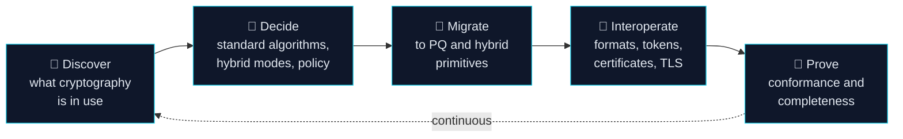

<p align="center">
  <picture>
    <source media="(prefers-color-scheme: dark)" srcset="https://raw.githubusercontent.com/PQBlocks/.github/main/profile/assets/banner-dark.svg">
    
  </picture>
</p>

<h3 align="center">Post-quantum building blocks you can read, test and verify.</h3>

<p align="center">
  Standards-based post-quantum cryptography, migration tooling and quantum-inspired optimisation:<br>
  small, focused packages that ship their evidence and state their limits.
</p>

<p align="center">
  <a href="#-what-pqblocks-covers"><b>Coverage</b></a> ·
  <a href="#-repositories"><b>Repositories</b></a> ·
  <a href="#-the-post-quantum-transition-mapped"><b>Transition map</b></a> ·
  <a href="#-standards-we-build-on"><b>Standards</b></a> ·
  <a href="#-quick-start"><b>Quick start</b></a> ·
  <a href="#-engineering-principles"><b>Principles</b></a> ·
  <a href="#-security--supply-chain"><b>Security</b></a> ·
  <a href="#-roadmap"><b>Roadmap</b></a>
</p>

<p align="center">
  
  
  
  
  
</p>

---

## 🧭 Why PQBlocks

A cryptographically relevant quantum computer would break RSA, Diffie–Hellman and elliptic-curve cryptography: the algorithms behind almost every TLS session, signature and encrypted archive today. Data captured now can be decrypted later (*harvest now, decrypt later*).

NIST has standardised the replacements: **ML-KEM** (FIPS 203), **ML-DSA** (FIPS 204) and **SLH-DSA** (FIPS 205). Swapping algorithms is the easy part. A real migration also needs:

| The transition needs… | Because… |
|---|---|
| **Inventory** | You cannot migrate cryptography you have not found. |
| **Correct implementations** | A wrong ML-KEM is worse than none. Conformance must be proven against official vectors. |
| **Interoperable formats** | Larger keys, ciphertexts and signatures must travel through real protocols and file formats. |
| **Hybrid modes** | Pairing post-quantum with proven classical algorithms keeps security if either one fails. |
| **Verification** | "We upgraded a library" is not proof that every path moved. |

**PQBlocks builds those pieces.** Each one is a small, independently installable package (for pip, npm or as an SDK) that does one job well, is tested against official vectors where they exist, and tells you plainly what it does **not** do.

---

## 🧩 What PQBlocks covers

PQBlocks is an ecosystem, not a single library. Every package belongs to one of five areas of the post-quantum transition:

<table>
<tr>
<td width="20%" valign="top" align="center"><h3>🔐</h3><b>PQ cryptography</b></td>
<td width="20%" valign="top" align="center"><h3>🧾</h3><b>Migration &amp; readiness</b></td>
<td width="20%" valign="top" align="center"><h3>📡</h3><b>Interoperability</b></td>
<td width="20%" valign="top" align="center"><h3>🔬</h3><b>Conformance</b></td>
<td width="20%" valign="top" align="center"><h3>🌀</h3><b>Quantum-inspired</b></td>
</tr>
<tr>
<td valign="top">ML-KEM, ML-DSA and SLH-DSA through maintained implementations; hybrid key exchange and signatures; safe defaults for files, tokens and messages.</td>
<td valign="top">Find the cryptography in code and on the wire, produce CBOMs, score readiness, enforce policy-as-code and crypto-agility gates in CI, and assemble compliance evidence.</td>
<td valign="top">Wire formats, JOSE / JWE, X.509 and CSR, and TLS hybrid groups: carrying larger post-quantum keys, ciphertexts and signatures through real protocols.</td>
<td valign="top">Run official NIST ACVP and Wycheproof vectors, cross-check implementations and prove a migration actually landed.</td>
<td valign="top">Classical solvers modelled on quantum dynamics, such as Ising and QUBO, annealing and bifurcation. Kept strictly separate from security: <b>no cryptographic claims</b>.</td>
</tr>
</table>

### Where you get them

| Channel | Naming | What ships there |
|---|---|---|
| 🐍 **PyPI** | `pqblocks-<name>` / `import pqblocks_<name>` | Python libraries and CLIs |
| 📦 **npm** | `pqblocks` packages | JavaScript / TypeScript modules for Node.js and the browser |
| 🧰 **SDKs** | per language | Client libraries that wrap a full workflow behind one API |

Each repository is named for what it does (`cbom-scanner`, `hybrid-jwe`, …). The package names carry the `pqblocks` prefix, so an install line always tells you where the code comes from.

---

## 📚 Repositories

The catalogue grows with every release. A package appears here only after it passes the full release checks (see [How we ship](#-engineering-principles)).

| Area | Repository | Package | Ecosystem | What it does | Status |
|---|---|---|---|---|---|
| 🔬 Conformance | [acvp-conformance](https://github.com/PQBlocks/acvp-conformance) | `pqblocks-acvp` | PyPI | Runs NIST ACVP vectors for FIPS 203 (ML-KEM) and FIPS 204 (ML-DSA) with a reference oracle and pluggable adapters, and reports every case | 0.1 alpha |
| 🧾 Migration | [cbom-scanner](https://github.com/PQBlocks/cbom-scanner) | `pqblocks-scan` | PyPI | Finds classical and post-quantum cryptography in source or on a TLS endpoint; emits CycloneDX 1.6 CBOM and SARIF 2.1.0 | 0.1 alpha |
| 📡 Interop | [pqc-wireformat](https://github.com/PQBlocks/pqc-wireformat) | `pqblocks-wire` | PyPI | Length-prefixed container for ML-KEM ciphertexts and ML-DSA / SLH-DSA signatures | 0.1 alpha |
| 📡 Interop | [hybrid-jwe](https://github.com/PQBlocks/hybrid-jwe) | `pqblocks-jwe` | PyPI | Compact token format for hybrid ML-KEM-768 + X25519 JWE-style messages (format only, no encryption) | 0.1 alpha |
| 🌀 Quantum-inspired | [simulated-bifurcation](https://github.com/PQBlocks/simulated-bifurcation) | `pqblocks-bifurcation` | PyPI | Ballistic and discrete Simulated Bifurcation for Ising / QUBO problems | 0.1 alpha |

> **Coming through review:** hybrid PQ file encryption, crypto-agility CI gates, PQ static analysis, policy-as-code, TLS hybrid interoperability, ML-KEM CSR proof-of-possession, CNSA 2.0 evidence packs, FIPS 203/204/205 primitives, a quantum-inspired optimisation suite, and the first **npm** modules and **SDKs**.

---

## 🗺️ The post-quantum transition, mapped



| Stage | PQBlocks today | Next |
|---|---|---|
| Discover | `cbom-scanner` | PQ static analysis |
| Decide | – | policy-as-code engine, CNSA 2.0 evidence |
| Migrate | – | hybrid file encryption, FIPS 203/204/205 primitives, SDKs |
| Interoperate | `pqc-wireformat`, `hybrid-jwe` | TLS hybrid interop, ML-KEM CSR proof-of-possession, npm modules |
| Prove | `acvp-conformance` | crypto-agility CI gates, interop matrix |

---

## 📐 Standards we build on

| Area | Standards and formats |
|---|---|
| Algorithms | NIST **FIPS 203** (ML-KEM) · **FIPS 204** (ML-DSA) · **FIPS 205** (SLH-DSA) · RFC 7748 (X25519) |
| Test vectors | NIST **ACVP** · **Wycheproof** |
| Inventory &amp; reporting | **CycloneDX 1.6** CBOM · **SARIF 2.1.0** |
| Formats &amp; protocols | JOSE / JWE (RFC 7516) · X.509 · TLS hybrid key exchange |
| Policy | NSA **CNSA 2.0** timelines · NIST migration guidance |

Every repository's `EVIDENCE.md` maps each standard it uses to the exact code that implements it, with links to the primary source. If a repository does not implement part of a standard, its docs say so.

---

## ⚡ Quick start

> **Package registries are being enabled.** Until a package's first release is live, install it straight from GitHub, e.g.
> `pip install "git+https://github.com/PQBlocks/cbom-scanner"`. Afterwards it is simply `pip install pqblocks-scan`.

<p><b>Python</b> (first releases; npm and SDK examples arrive with those packages)</p>

<details open>
<summary><b>Inventory a codebase</b>: <code>pqblocks-scan</code></summary>

```python
from pqblocks_scan.discovery import Discovery
from pqblocks_scan.scorer import CARSScorer
from pqblocks_scan.cbom import CBOMGenerator

src = "import hashlib\nh = hashlib.sha1(b'x').hexdigest()\nfrom pqcrypto.kem import ml_kem_768\n"
assets = Discovery().discover_source(src, "app.py").assets
print([(a.algorithm, a.line_number, a.is_quantum_vulnerable) for a in assets])
# [('ML-KEM-768', 3, False), ('SHA-1', 2, True)]
print(CBOMGenerator.generate(assets)["specVersion"])   # 1.6
```
</details>

<details>
<summary><b>Carry an ML-KEM ciphertext</b>: <code>pqblocks-wire</code></summary>

```python
from pqblocks_wire import (generate_mlkem_keypair, encapsulate_mlkem, decapsulate_mlkem,
                           encode_wire_format, decode_wire_format)

pk, sk = generate_mlkem_keypair("ML-KEM-768")
ct, ss_sender = encapsulate_mlkem(pk, "ML-KEM-768")
frame = encode_wire_format(mlkem_ciphertext=ct, payload=b"hello")
received = decode_wire_format(frame)
ss_receiver = decapsulate_mlkem(sk, received.mlkem_ciphertext, "ML-KEM-768")
print(ss_sender == ss_receiver, received.payload)       # True b'hello'
```
</details>

<details>
<summary><b>Prove conformance with ACVP vectors</b>: <code>pqblocks-acvp</code></summary>

```python
from pqblocks_acvp.runner import build_golden_session
from pqblocks_acvp.harness import ConformanceHarness
from pqblocks_acvp.adapters.reference import ReferencePQCAdapter

reports = ConformanceHarness([ReferencePQCAdapter()]).run_session(build_golden_session())
rep = reports["Reference-FIPS-Oracle"]
print(rep.total_attempted, rep.passed, rep.denominator_verified)   # 4 4 True
```
</details>

<details>
<summary><b>Solve an Ising problem</b>: <code>pqblocks-bifurcation</code></summary>

```python
import numpy as np
from pqblocks_bifurcation.solver import SimulatedBifurcationSampler

spins, energy = SimulatedBifurcationSampler(seed=42, mode="dSB").sample_ising(
    np.array([[0.0, -1.0], [-1.0, 0.0]]), np.array([0.5, -0.5]))
print(spins, energy)                                     # [1 1] -1.0
```
</details>

---

## 🧱 Engineering principles

<table>
<tr><td>🚫</td><td><b>No new cryptography.</b> We implement and wrap standardised, peer-reviewed algorithms only, through maintained libraries such as liboqs and pyca/cryptography. See the <a href="https://github.com/PQBlocks/.github/blob/main/CRYPTO-POLICY.md">cryptography policy</a>.</td></tr>
<tr><td>🌐</td><td><b>Same bar in every ecosystem.</b> pip, npm and SDK releases follow one checklist: official vectors, fresh-install tests, leak-free docs, a security review and a published verification report.</td></tr>
<tr><td>🎯</td><td><b>Official vectors are the reference.</b> Correctness is checked against NIST ACVP and Wycheproof vectors, vendored byte-for-byte with their source.</td></tr>
<tr><td>🔗</td><td><b>Hybrid by default.</b> Post-quantum is paired with classical where protocols allow it. Downgrades are explicit, never silent.</td></tr>
<tr><td>🧪</td><td><b>Tested as users install it.</b> Every release candidate is built, installed from its own artifact into a clean environment, and tested on every supported runtime (Python 3.11 – 3.14 today), examples included.</td></tr>
<tr><td>📊</td><td><b>Benchmarks with losing cases.</b> We publish where we lose and where comparisons are not like-for-like.</td></tr>
<tr><td>🪪</td><td><b>Honest limits.</b> Every package is self-verified and says so. Constant-time status, side-channel posture and audit status are written down. Nothing here claims FIPS or CMVP validation.</td></tr>
</table>

### What every repository ships

| File | What it gives you |
|---|---|
| `README.md` | What it does, when to use it, a runnable example, the real API |
| `TESTING.md` | Fresh test results per Python version, coverage, official vectors used |
| `BENCHMARKS.md` | Setup, raw results, losing cases, fairness caveats, how to reproduce |
| `EVIDENCE.md` | Standards and papers, mapped to the code that implements them |
| `VERIFICATION_REPORT.md` | What was checked, how, and the defects found and fixed |
| `SECURITY_NOTES.md` | What it protects and what it does not, open review findings |
| `USE_CASES.md` | Real scenarios with runnable snippets |
| `AGENTS.md` | Correct usage for AI coding assistants |

---

## 🛡️ Security & supply chain

- **Private vulnerability reporting** is enabled on every repository. Please report issues there, never in public. See the [security policy](https://github.com/PQBlocks/.github/blob/main/SECURITY.md) (acknowledgement within 3 working days, coordinated disclosure normally within 90 days).
- **Secret scanning with push protection**, **Dependabot alerts** and **protected `main` branches** are on across the organisation.
- **Release pipeline (being enabled):** packages are built in CI and published to PyPI with **Trusted Publishing** (no long-lived tokens), signed with **Sigstore**, and shipped with a **CycloneDX SBOM**. Every PyPI release requires maintainer approval, and GitHub Actions are pinned by commit SHA.

---

## 🛣️ Roadmap

| Track | Now | Next |
|---|---|---|
| 🔐 PQ cryptography | (in review) | hybrid file encryption · FIPS 203/204/205 primitives |
| 🧾 Migration & readiness | cbom-scanner | PQ static analysis · policy-as-code · crypto-agility CI gates · CNSA 2.0 evidence |
| 📡 Interoperability | pqc-wireformat · hybrid-jwe | TLS hybrid interop · ML-KEM CSR proof-of-possession |
| 🔬 Conformance | acvp-conformance | SLH-DSA (FIPS 205) vectors · cross-implementation interop matrix |
| 🌀 Quantum-inspired | simulated-bifurcation | QUBO core · annealing family · benchmark harness |
| 📦 Ecosystems | PyPI | **npm** modules · language **SDKs** |
| 🧭 Developer experience | `AGENTS.md` in every repo | documentation site · `llms.txt` · MCP helper for coding assistants |

A package moves from review to release only when its tests, official vectors, fresh-install checks and security review all pass.

---

## 🤝 Contributing

Issues, reviews and pull requests are welcome, from cryptographers and practitioners alike. Start with [CONTRIBUTING.md](https://github.com/PQBlocks/.github/blob/main/CONTRIBUTING.md) and the [cryptography policy](https://github.com/PQBlocks/.github/blob/main/CRYPTO-POLICY.md). Our [code of conduct](https://github.com/PQBlocks/.github/blob/main/CODE_OF_CONDUCT.md) applies in every space.

<details>
<summary><b>FAQ</b></summary>

**Which languages do you support?**
Python first (PyPI). JavaScript / TypeScript modules on npm and language SDKs follow, built to the same release bar.

**Is PQBlocks production-ready?**
Not yet. Every package released so far is `0.1` alpha: self-verified, tested against official vectors where they exist, but not externally audited. Read each `SECURITY_NOTES.md` before relying on it.

**Do you implement ML-KEM yourselves?**
No. We wrap maintained implementations (for example liboqs and pyca/cryptography in Python) and test our integration against official vectors. Where a pure-Python reference is used, for example as a conformance oracle, it is stated.

**Is anything here FIPS or CMVP validated?**
No. "Implements FIPS 203" and "FIPS 140-3 validated" are different claims, and we only make the first, where it is true.

**What is "quantum-inspired" optimisation?**
Classical algorithms modelled on quantum dynamics, such as Simulated Bifurcation. They run on ordinary CPUs, provide no cryptographic security, and are kept clearly separate from the cryptography packages.

</details>

---

<p align="center">
  <sub><b>PQBlocks</b> · Post-Quantum Building Blocks · Apache-2.0 · <a href="https://github.com/PQBlocks/.github/blob/main/SECURITY.md">Security</a> · <a href="https://github.com/PQBlocks/.github/blob/main/CRYPTO-POLICY.md">Cryptography policy</a></sub>
</p>
