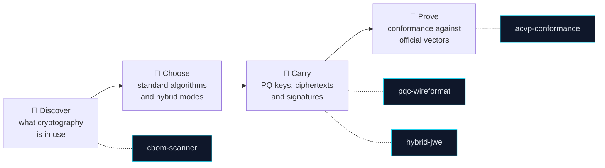

<p align="center">
  <picture>
    <source media="(prefers-color-scheme: dark)" srcset="https://raw.githubusercontent.com/PQBlocks/.github/main/profile/assets/banner-dark.svg">
    
  </picture>
</p>

<h3 align="center">Post-quantum building blocks you can read, test and verify.</h3>

<p align="center">
  Standards-based post-quantum cryptography, migration tooling and quantum-inspired optimisation for Python:<br>
  small, focused packages that ship their evidence and state their limits.
</p>

<p align="center">
  <a href="#-packages"><b>Packages</b></a> ·
  <a href="#-the-post-quantum-transition-mapped"><b>Transition map</b></a> ·
  <a href="#-standards-coverage"><b>Standards</b></a> ·
  <a href="#-quick-start"><b>Quick start</b></a> ·
  <a href="#-engineering-principles"><b>Principles</b></a> ·
  <a href="#-security--supply-chain"><b>Security</b></a> ·
  <a href="#-roadmap"><b>Roadmap</b></a>
</p>

<p align="center">
  
  
  
  
  
</p>

---

## 🧭 Why PQBlocks

A cryptographically relevant quantum computer would break RSA, Diffie–Hellman and elliptic-curve cryptography: the algorithms behind almost every TLS session, signature and encrypted archive today. Data captured now can be decrypted later (*harvest now, decrypt later*).

NIST has standardised the replacements: **ML-KEM** (FIPS 203), **ML-DSA** (FIPS 204) and **SLH-DSA** (FIPS 205). Swapping algorithms is the easy part. A real migration also needs:

| The transition needs… | Because… |
|---|---|
| **Inventory** | You cannot migrate cryptography you have not found. |
| **Correct implementations** | A wrong ML-KEM is worse than none. Conformance must be proven against official vectors. |
| **Interoperable formats** | Larger keys, ciphertexts and signatures must travel through real protocols and file formats. |
| **Hybrid modes** | Pairing post-quantum with proven classical algorithms keeps security if either one fails. |
| **Verification** | "We upgraded a library" is not proof that every path moved. |

**PQBlocks builds those pieces.** Each one is a small, independently installable Python package that does one job well, is tested against official vectors where they exist, and tells you plainly what it does **not** do.

---

## 📦 Packages

<table>
<tr>
<td width="50%" valign="top">

### 🔬 [acvp-conformance](https://github.com/PQBlocks/acvp-conformance)
`pqblocks-acvp` · **Conformance**

Runs NIST ACVP test vectors for **FIPS 203 (ML-KEM)** and **FIPS 204 (ML-DSA)** across implementations through pluggable adapters, and reports every case with a verified denominator, so a "pass" cannot hide skipped vectors.

`ACVP` `ML-KEM` `ML-DSA` `FIPS 203` `FIPS 204`

</td>
<td width="50%" valign="top">

### 🧾 [cbom-scanner](https://github.com/PQBlocks/cbom-scanner)
`pqblocks-scan` · **Inventory**

Finds classical and post-quantum algorithms in Python source or on a TLS endpoint, scores readiness, and emits a **CycloneDX 1.6** cryptographic bill of materials and **SARIF 2.1.0** for CI. Zero runtime dependencies.

`CBOM` `CycloneDX 1.6` `SARIF` `CNSA 2.0`

</td>
</tr>
<tr>
<td width="50%" valign="top">

### 📡 [pqc-wireformat](https://github.com/PQBlocks/pqc-wireformat)
`pqblocks-wire` · **Interoperability**

A small, length-prefixed binary container (`PQCWF1`) that carries ML-KEM ciphertexts and ML-DSA / SLH-DSA signatures, with thin wrappers over liboqs and pyca/cryptography.

`ML-KEM` `ML-DSA` `SLH-DSA` `liboqs`

</td>
<td width="50%" valign="top">

### 🔐 [hybrid-jwe](https://github.com/PQBlocks/hybrid-jwe)
`pqblocks-jwe` · **Hybrid formats**

A compact five-part token format for hybrid **ML-KEM-768 + X25519** JWE-style messages, with a serializer and a structural parser. It carries ciphertexts; it does not encrypt.

`JOSE` `JWE` `ML-KEM-768` `X25519`

</td>
</tr>
<tr>
<td colspan="2" valign="top">

### 🌀 [simulated-bifurcation](https://github.com/PQBlocks/simulated-bifurcation)
`pqblocks-bifurcation` · **Quantum-inspired optimisation**

Ballistic and discrete Simulated Bifurcation (Goto et al., *Science Advances* 2019 and 2021) for Ising and QUBO problems such as Max-Cut, on a CPU with Numba. A classical heuristic inspired by quantum dynamics: **not cryptography, no security claim**.

`Ising` `QUBO` `Max-Cut` `Numba`

</td>
</tr>
</table>

| Package | Install name | Runtime dependencies | Version |
|---|---|---|---|
| acvp-conformance | `pqblocks-acvp` | kyber-py, dilithium-py (reference oracle) | 0.1.0 |
| cbom-scanner | `pqblocks-scan` | none | 0.1.0 |
| pqc-wireformat | `pqblocks-wire` | cryptography, liboqs-python (+ system liboqs) | 0.1.0 |
| hybrid-jwe | `pqblocks-jwe` | jwcrypto | 0.1.0 |
| simulated-bifurcation | `pqblocks-bifurcation` | numpy, numba, scipy | 0.1.0 |

---

## 🗺️ The post-quantum transition, mapped



> Optimisation workloads sit alongside this track: [simulated-bifurcation](https://github.com/PQBlocks/simulated-bifurcation) is our first quantum-inspired solver.

---

## 📐 Standards coverage

| Standard / format | acvp-conformance | cbom-scanner | pqc-wireformat | hybrid-jwe |
|---|:---:|:---:|:---:|:---:|
| **FIPS 203** ML-KEM | ✅ vectors | ✅ detects | ✅ carries | ✅ carries (768) |
| **FIPS 204** ML-DSA | ✅ vectors | ✅ detects | ✅ carries | – |
| **FIPS 205** SLH-DSA | – | ✅ detects | ✅ carries | – |
| NIST **ACVP** vector format | ✅ | – | – | – |
| **CycloneDX 1.6** CBOM | – | ✅ | – | – |
| **SARIF 2.1.0** | – | ✅ | – | – |
| **RFC 7516** JWE (shape) | – | – | – | ✅ |
| **RFC 7748** X25519 | – | – | – | ✅ |

Each repository's `EVIDENCE.md` maps every standard to the exact code that implements it.

---

## ⚡ Quick start

> **PyPI publishing is being enabled.** Until the first release is live, install straight from GitHub, e.g.
> `pip install "git+https://github.com/PQBlocks/cbom-scanner"`. After that it is simply `pip install pqblocks-scan`.

<details open>
<summary><b>Inventory a codebase</b>: <code>pqblocks-scan</code></summary>

```python
from pqblocks_scan.discovery import Discovery
from pqblocks_scan.scorer import CARSScorer
from pqblocks_scan.cbom import CBOMGenerator

src = "import hashlib\nh = hashlib.sha1(b'x').hexdigest()\nfrom pqcrypto.kem import ml_kem_768\n"
assets = Discovery().discover_source(src, "app.py").assets
print([(a.algorithm, a.line_number, a.is_quantum_vulnerable) for a in assets])
# [('ML-KEM-768', 3, False), ('SHA-1', 2, True)]
print(CBOMGenerator.generate(assets)["specVersion"])   # 1.6
```
</details>

<details>
<summary><b>Carry an ML-KEM ciphertext</b>: <code>pqblocks-wire</code></summary>

```python
from pqblocks_wire import (generate_mlkem_keypair, encapsulate_mlkem, decapsulate_mlkem,
                           encode_wire_format, decode_wire_format)

pk, sk = generate_mlkem_keypair("ML-KEM-768")
ct, ss_sender = encapsulate_mlkem(pk, "ML-KEM-768")
frame = encode_wire_format(mlkem_ciphertext=ct, payload=b"hello")
received = decode_wire_format(frame)
ss_receiver = decapsulate_mlkem(sk, received.mlkem_ciphertext, "ML-KEM-768")
print(ss_sender == ss_receiver, received.payload)       # True b'hello'
```
</details>

<details>
<summary><b>Prove conformance with ACVP vectors</b>: <code>pqblocks-acvp</code></summary>

```python
from pqblocks_acvp.runner import build_golden_session
from pqblocks_acvp.harness import ConformanceHarness
from pqblocks_acvp.adapters.reference import ReferencePQCAdapter

reports = ConformanceHarness([ReferencePQCAdapter()]).run_session(build_golden_session())
rep = reports["Reference-FIPS-Oracle"]
print(rep.total_attempted, rep.passed, rep.denominator_verified)   # 4 4 True
```
</details>

<details>
<summary><b>Solve an Ising problem</b>: <code>pqblocks-bifurcation</code></summary>

```python
import numpy as np
from pqblocks_bifurcation.solver import SimulatedBifurcationSampler

spins, energy = SimulatedBifurcationSampler(seed=42, mode="dSB").sample_ising(
    np.array([[0.0, -1.0], [-1.0, 0.0]]), np.array([0.5, -0.5]))
print(spins, energy)                                     # [1 1] -1.0
```
</details>

---

## 🧱 Engineering principles

<table>
<tr><td>🚫</td><td><b>No new cryptography.</b> We implement and wrap standardised, peer-reviewed algorithms only, through maintained libraries such as liboqs and pyca/cryptography. See the <a href="https://github.com/PQBlocks/.github/blob/main/CRYPTO-POLICY.md">cryptography policy</a>.</td></tr>
<tr><td>🎯</td><td><b>Official vectors are the reference.</b> Correctness is checked against NIST ACVP and Wycheproof vectors, vendored byte-for-byte with their source.</td></tr>
<tr><td>🔗</td><td><b>Hybrid by default.</b> Post-quantum is paired with classical where protocols allow it. Downgrades are explicit, never silent.</td></tr>
<tr><td>🧪</td><td><b>Tested as users install it.</b> Every release candidate is built, installed into a fresh environment from its wheel, and tested on Python 3.11, 3.12, 3.13 and 3.14, examples included.</td></tr>
<tr><td>📊</td><td><b>Benchmarks with losing cases.</b> We publish where we lose and where comparisons are not like-for-like.</td></tr>
<tr><td>🪪</td><td><b>Honest limits.</b> Every package is self-verified and says so. Constant-time status, side-channel posture and audit status are written down. Nothing here claims FIPS or CMVP validation.</td></tr>
</table>

### What every repository ships

| File | What it gives you |
|---|---|
| `README.md` | What it does, when to use it, a runnable example, the real API |
| `TESTING.md` | Fresh test results per Python version, coverage, official vectors used |
| `BENCHMARKS.md` | Setup, raw results, losing cases, fairness caveats, how to reproduce |
| `EVIDENCE.md` | Standards and papers, mapped to the code that implements them |
| `VERIFICATION_REPORT.md` | What was checked, how, and the defects found and fixed |
| `SECURITY_NOTES.md` | What it protects and what it does not, open review findings |
| `USE_CASES.md` | Real scenarios with runnable snippets |
| `AGENTS.md` | Correct usage for AI coding assistants |

---

## 🛡️ Security & supply chain

- **Private vulnerability reporting** is enabled on every repository. Please report issues there, never in public. See the [security policy](https://github.com/PQBlocks/.github/blob/main/SECURITY.md) (acknowledgement within 3 working days, coordinated disclosure normally within 90 days).
- **Secret scanning with push protection**, **Dependabot alerts** and **protected `main` branches** are on across the organisation.
- **Releases** are built in CI and published to PyPI with **Trusted Publishing** (no long-lived tokens), signed with **Sigstore**, and shipped with a **CycloneDX SBOM**. Every PyPI release requires maintainer approval. GitHub Actions are pinned by commit SHA.

---

## 🛣️ Roadmap

| Stage | What |
|---|---|
| ✅ **Released (0.1 alpha)** | acvp-conformance · cbom-scanner · pqc-wireformat · hybrid-jwe · simulated-bifurcation |
| 🔍 **In security review** | hybrid post-quantum file encryption · crypto-agility CI gate · post-quantum static analysis · policy-as-code engine · TLS hybrid interoperability · ML-KEM CSR proof-of-possession · CNSA 2.0 evidence packs · FIPS 203/204/205 primitives |
| 🧩 **Planned** | SLH-DSA (FIPS 205) conformance vectors · quantum-inspired optimisation suite (QUBO core, annealing family, benchmark harness) · documentation site · `llms.txt` and an MCP helper for coding assistants |

Packages move from review to release only when their tests, official vectors, fresh-install checks and security review all pass.

---

## 🤝 Contributing

Issues, reviews and pull requests are welcome, from cryptographers and practitioners alike. Start with [CONTRIBUTING.md](https://github.com/PQBlocks/.github/blob/main/CONTRIBUTING.md) and the [cryptography policy](https://github.com/PQBlocks/.github/blob/main/CRYPTO-POLICY.md). Our [code of conduct](https://github.com/PQBlocks/.github/blob/main/CODE_OF_CONDUCT.md) applies in every space.

<details>
<summary><b>FAQ</b></summary>

**Is PQBlocks production-ready?**
Not yet. Every package is `0.1` alpha: self-verified, tested against official vectors where they exist, but not externally audited. Read each `SECURITY_NOTES.md` before relying on it.

**Do you implement ML-KEM yourselves?**
No. We wrap maintained implementations (liboqs, pyca/cryptography) and test our integration against official vectors. Where a pure-Python reference is used, for example as a conformance oracle, it is stated.

**Is anything here FIPS or CMVP validated?**
No. "Implements FIPS 203" and "FIPS 140-3 validated" are different claims, and we only make the first, where it is true.

**What is "quantum-inspired" optimisation?**
Classical algorithms modelled on quantum dynamics, such as Simulated Bifurcation. They run on ordinary CPUs, provide no cryptographic security, and are kept clearly separate from the cryptography packages.

</details>

---

<p align="center">
  <sub><b>PQBlocks</b> · Post-Quantum Building Blocks · Apache-2.0 · <a href="https://github.com/PQBlocks/.github/blob/main/SECURITY.md">Security</a> · <a href="https://github.com/PQBlocks/.github/blob/main/CRYPTO-POLICY.md">Cryptography policy</a></sub>
</p>
